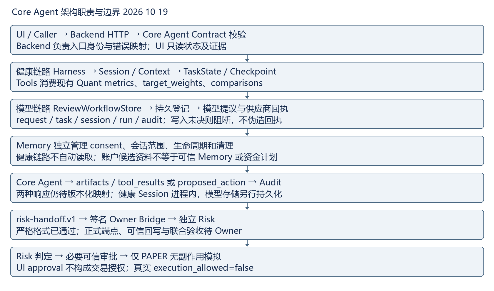
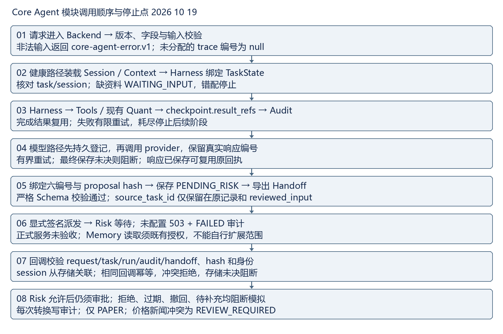

# Core Agent 主链路联调手册 2026-10-19

已实现双链路与字段边界；已验证严格 Schema 和语义追踪；正式 Risk 审核闭环待 Owner 确认。本手册供 Agent、Backend、Risk、UI、Memory、Quant 逐字段对照，不修改运行时版本。旧文档中的 source_task_id 格式阻塞已修复，以本版为准。

## 架构职责与数据流

- Core Agent：组织结果、版本与 Handoff；不重算 Quant，不产生授权。
- Backend：HTTP、Contract、身份、错误映射与审计读取；消费原始 ID，不改证据。
- Harness：健康四阶段调度、有限重试、结果复用；唯一维护 TaskState/Checkpoint。
- Session 与 Context：健康 session 绑定、actor/environment/data_mode；模型 session 只是关联字段，不证明共用 Session 存储。
- TaskState：stage/status/checkpoint/completed/result_refs/resume_token；会话错配、缺输入、失败停止。
- Tools 与 Quant：validatePortfolio、diagnosePortfolio、generateCandidates、runSimulation；工具拥有版本/日期/输出。
- Memory：独立接口，显式 consent 与会话范围；健康链路不自动读取，调用方材料不是可信记忆。
- Risk：消费证据、校验 hash/身份、独立决策；正式接收/回写待 Owner 确认。
- UI：只消费状态、产物和恢复信息；不改审批身份、风险决策或 execution_allowed。
- Audit：健康 audit_evidence 与模型 audit.events 两种表示；不是 Memory，持久化能力按链路区分。

## 模块时序与停止点

1. 01 请求进入 Backend → 版本、字段与输入校验；非法输入返回 core-agent-error.v1；未分配的 trace 编号为 null。

2. 02 健康路径装载 Session / Context → Harness 绑定 TaskState；核对 task/session；缺资料 WAITING_INPUT，错配停止。

3. 03 Harness → Tools / 现有 Quant → checkpoint.result_refs → Audit；完成结果复用；失败有限重试，耗尽停止后续阶段。

4. 04 模型路径先持久登记，再调用 provider，保留真实响应编号；有界重试；最终保存未决则阻断；响应已保存可复用原回执。

5. 05 绑定六编号与 proposal hash → 保存 PENDING_RISK → 导出 Handoff；严格 Schema 校验通过；source_task_id 仅保留在原记录和 reviewed_input。

6. 06 显式签名派发 → Risk 等待；未配置 503 + FAILED 审计；正式服务未验收；Memory 读取须既有授权，不能自行扩展范围。

7. 07 回调校验 request/task/run/audit/handoff、hash 和身份；session 从存储关联；相同回调幂等，冲突拒绝，存储未决阻断。

8. 08 Risk 允许后仍须审批；拒绝、过期、撤回、待补充均阻断模拟；每次转换写审计；仅 PAPER；价格新闻冲突为 REVIEW_REQUIRED。

## 统一 Contract 输入输出与必填字段

以下 required 直接读取当前 Schema；可 null 不等于可以省略，可选不等于旧任务已有。编号和引用还须语义校验。

### HealthCheckRequest

版本 investment-agent.v1；生产消费 Caller/Backend → Core/Harness；约束源 contracts/investment-agent.v1.schema.json。

必填：contract_version, request_id, operation, context, input。

### HealthCheckResponse

版本 investment-agent.v1；生产消费 Core/Harness → Backend/Risk/UI；约束源 contracts/investment-agent.v1.schema.json。

必填：contract_version, request_id, operation, trace, task_state, artifacts, tool_results, audit_evidence, risk_handoff。

### ReviewRequest

版本 model-review.v1；生产消费 Caller → Backend；约束源 contracts/model-review.v1.schema.json。

必填：kind, text。

### WorkflowRecord

版本 review-workflow.v1；生产消费 Backend/ReviewWorkflowStore → Risk/UI；约束源 contracts/model-review.v1.schema.json。

必填：workflow_version, task_id, request_id, run_id, status, model, proposed_action, risk_handoff, risk_decision, approval, execution, audit。

### HandoffPackage

版本 risk-handoff.v1；生产消费 Core → Risk；约束源 contracts/risk-handoff.v1.schema.json。

必填：handoff_version, contract_version, workflow_version, schema_version, handoff_id, task_id, request_id, session_id, run_id, audit_id, data_mode, execution_mode, capability, plan_id, plan_hash, policy_version, owner, record_endpoint, workflow_status, status, decision, execution_allowed, proposal, reviewed_input, input_authority, model, evidence, approval, audit, memory_write_status, trace, callback。

### CallbackRequest

版本 risk-callback.v1；生产消费 Risk → Backend；约束源 contracts/risk-handoff.v1.schema.json。

必填：handoff_id, task_id, request_id, run_id, audit_id, reviewer, reason, callback_version, proposal_sha256, decision。

### SharedErrorEnvelope

版本 core-agent-error.v1；生产消费 Backend/Core → Caller/UI；约束源 contracts/core-agent-error.v1.schema.json。

必填：error_contract_version, source_contract_version, operation, request_id, trace, error。

## 字段归属与禁止修改

- contract_version/schema_version/workflow_version：对应 Contract 维护者冻结，Backend 校验并传递，Risk/UI 不临时改写版本。共享错误另有 error_contract_version/source_contract_version。
- request_id：Caller 或 Backend 入口确定；Core Agent 绑定当前请求，Risk/UI 引用不得改写。同任务重复请求可有新 request_id，历史审计 payload 保留原请求，不能覆盖历史证据。
- task_id/session_id：对应 Harness/ReviewWorkflowStore 创建或绑定；Backend/Risk/UI 消费不可替换关联。健康 session 是状态绑定；模型 session_id 可选且可 null，不能用 run_id 冒充 session。
- task_state/checkpoint：健康 Harness 唯一推进，Backend/UI/Risk 只读；completed/result_refs 必须引用存在的工具结果。模型 WorkflowRecord 使用 status，不具同名 task_state；映射待 Backend。
- artifacts/tool_results：现有工具/Quant 生产数值、版本、日期，Core Agent 组织引用；其他消费者不重新计算、不改原值。模型 proposed_action/model 并非已标准化的同名字段。
- risk_handoff：Core Agent 根据当前产物与审计装配，Risk 消费并通过独立回调产生决策；UI 不批准、不改 hash。健康 Handoff 与模型 HandoffPackage 不可直接混用。
- audit_evidence：健康 Harness/Core Agent 生产，模型用 audit.events。run_id/audit_id/handoff_id 按所属任务链生成，消费者原样引用，事件不可改写；模型存储持久化不证明健康 Session/Checkpoint 已跨重启持久化。
- error envelope：Backend/Core Agent 生产，Caller/UI 消费，code/message/retryable/stage/recovery 必填；trace 必填版本及 request/task/session/run/audit/handoff，未分配时可 null。不能凭 UI 文案将失败改为成功。
- source_task_id：当前仅在原模型记录与 reviewed_input 保留，不是 HandoffPackage 顶层字段；顶层别名已由当天业务提交移除，冻结 Schema 不变且复验通过。

## 状态与追踪限制

健康 WAITING_INPUT/BLOCKED/FAILED/CIRCUIT_OPEN 阻止后续阶段，HANDOFF_REQUIRED 为交接停止点。模型 status 枚举：PENDING_RISK, PENDING_APPROVAL, READY_FOR_SIMULATION, SIMULATED, REJECTED, EXPIRED, MODEL_FAILED, FUNDING_BLOCKED, CANCELLED。risk_dispatch.status 是另一字段，不替代任务 status；存储结果未决需等待核查，不自动换键重试。

WorkflowRecord.session_id 可选；HandoffPackage.session_id 必填可 null。回调只要求 request/task/run/audit/handoff 五编号，session 由存储关联。健康四个响应字段在模型记录中仍无版本化同名映射。健康 Session/Checkpoint 为进程内；模型存储登记与回执恢复不等于健康跨进程恢复。失效 checkpoint 引用可能结构合法但语义非法，需两类校验。audit_evidence 与 audit.events 不能仅凭名字当作同一个对象。

## 本轮验证与待确认

- 两仓库在 chenchen 运行 npm run check：exit 0；npm test -- --test-reporter=tap：各 258/258 通过，失败/跳过 0；原始日志 daily-closeout-2026-10-19-check.txt、daily-closeout-2026-10-19-tests.txt。
- 两仓库在 chenchen 运行 python docs/daily-closeout-check-2026-10-19.py：各 32/32 通过；7 个正向对象完整 Draft 2020-12 Schema 全通过。新合成健康成功、同进程 Checkpoint 复用及失败信封可追踪；10 月 17 日留存合成模型记录的 9 条事件六编号与 hash 一致，明确不是新真实模型记录。证据 daily-closeout-2026-10-19-trace.json、synthetic.json。
- 两仓库在 chenchen 运行 node --input-type=module -e 'import {runGoldenPath} from "./experiments/golden-path-v1/run.mjs"; const value=await runGoldenPath({writeArtifacts:false}); console.log(JSON.stringify(value,null,2));'：本轮新运行 PASS，批准与拒绝两条本地合成路径、原始请求响应和状态留在 daily-closeout-2026-10-19-golden.json；模型替身，正式 Risk/付费模型/真实网关调用均 0。
- 完整 Schema 校验依赖 Python jsonschema==4.26.0、Node >=22；本机使用工作区 bundled Python/Node，jsonschema 安装在自动化独立 python-deps 并由 PYTHONPATH 加载，未改项目依赖。初次因缺依赖失败，补齐后复跑通过；不是绕过检查。
- 已复核当天已有部署回执：/health、/docs、/api/review/capabilities 均 HTTP 200，inference_probe=NOT_RUN，Risk/可信审批/执行网关未就绪。本次未重跑公网请求、模型推理或 Risk 派发，不把只读健康结果视为正式联调验收。
- 提交前运行 git diff --check 和 git diff --cached --check，原始结果见 daily-closeout-2026-10-19-git-check.txt；只提交本轮白名单 docs 文件。团队未跟踪 benchmark 实验保留，不纳入本次验证或提交。

- Risk：缺正式接收地址、可信服务身份、签名回写与联合验收；期望提供接收/拒绝/补资料/重复/冲突/过期及存储未决的收发样例。现有消费者要求非空 provider_response_id，需确认供应商无编号时的拒绝及恢复协议，Core 不生成假编号。
- Backend：健康与模型响应仍无版本化统一映射，健康 Session/Checkpoint 仍进程内；期望 task_state/artifacts/tool_results/audit_evidence 对照、持久化和跨实例幂等方案。模型持久登记测试不能证明健康链路跨进程恢复。
- Backend 与 Risk：可信审批身份、权限与 Safety Action Gateway 缺失；期望受保护入口、可核验审批和执行前再检查 Contract，真实执行持续关闭。
- UI：候选固定旧 Core 基线，任务找回/脱敏 trace、本人查询、稳定幂等键和 503 retryable:false 仍需对齐；期望最新基线的等待/拒绝/缺资料/过期/409/503 恢复联调回执。本次无新浏览器验收。
- Memory：缺授权下的可信引用与撤回证据；期望 memory_id、来源/版本和授权样例，不改变既有规则。
- Quant 与 Data：缺共同冻结的结果版本/日期、账户及持仓来源、真实快照、出入金/冻结资金和时效冲突协议；期望可审计样例，不能以截图差额补成持仓或可投资额度。

## 图像与版式验收

Word 日报与手册已生成，架构和时序以可读图像嵌入，完成 OOXML/ZIP/文本/图片宽度检查。尝试 canonical render_docx.py，当前 bundled 环境缺少 LibreOffice soffice.exe，未生成页面 PNG，逐页版式验收未完成；不能标记版式通过。日志 daily-closeout-2026-10-19-render.txt。

