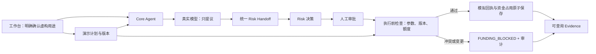
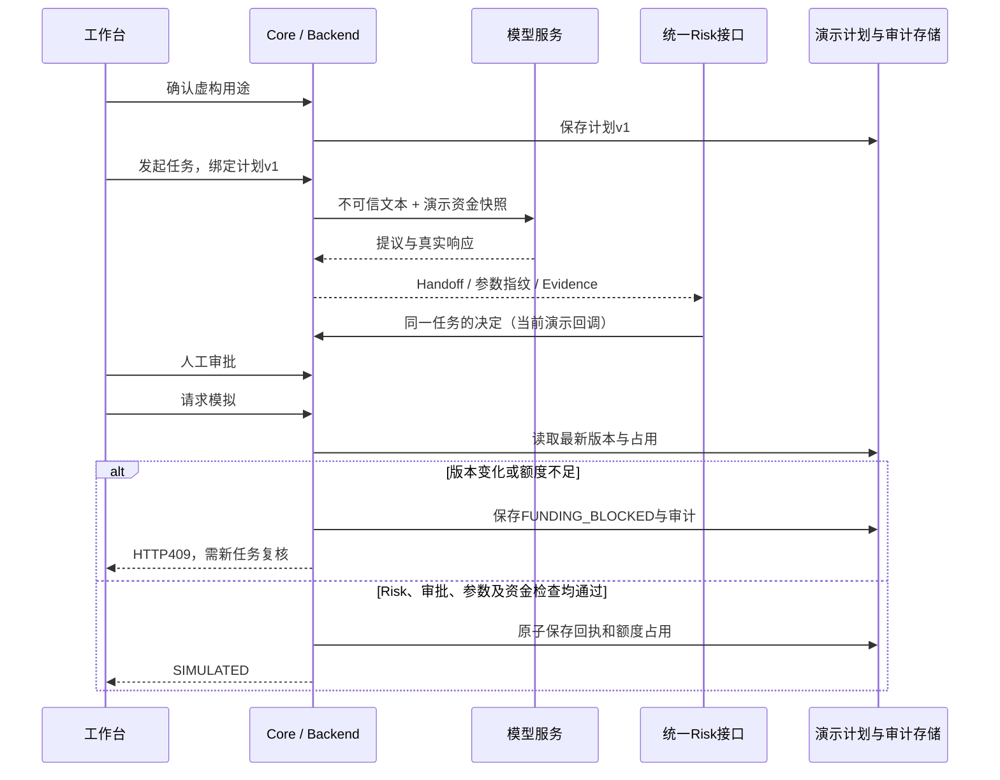

# 投资前用钱冲突体检 · 资金用途保护迭代
日期：2026-10-14。范围：Core Agent 主链路、接口适配与模拟执行检查。

## 这次用户能看到什么

先确认“手里有多少钱、多少要留给房租”，页面突出生活费预留、已模拟占用、还能安排三个数字。填写本次拟议投资金额后，真实模型给出解释，Risk 和人工审批各自留记录，最后才能模拟。模型解释、术语提示和完整日志默认折叠，旧版持仓联调入口保留。

例如现金10000元、房租4000元，当前可安排6000元。提出8000元投资会被资金检查阻断；先后提出两笔4000元，第一笔模拟后，第二笔不能继续用之前看到的6000元额度。即使审批已通过，修改房租用途后也必须新建任务重新复核。

这些是隔离的虚构资金计划；没有接真实账户，不是投资建议。

## 主链路与职责



- Quant：沿用其职责，不重新计算收益、配置或市场指标。本轮仅做整数分的演示资金余额记账。
- Memory：规则和存储不变。资金计划标为 `DEMO_USER_CONFIRMED_NOT_TRUSTED_MEMORY`，等待 Memory Owner 提供正式可信引用。
- Risk：统一回调仍先于审批与执行；Core 的额度检查只能增加阻断，不能签发 Risk 批准。当前 Risk/审批仍由演示按钮或测试脚本扮演。
- UI：展示数字与阻断原因，不将模型建议等同于授权；本地仅记住虚构计划编号。
- Execution：没有真实网关，`execution_allowed=false`；模拟回执 `side_effects=false` 表示无外部金融动作，内部演示额度仍会记账。

## 统一接口

公网地址：`https://personal-ai-fund-manager-core-agent.realchenchenluo.workers.dev`。

| 接口 | 输入/输出要点 |
| --- | --- |
| POST /api/funding-demo/plan | synthetic=true、confirmed=true、currency=CNY、cash_minor、protected_purposes；返回计划编号、版本、余额与历史 |
| POST /api/funding-demo/plan/revise | 同上，增加 plan_id、expected_revision；版本不匹配返回409，保留已有占用与历史 |
| GET /api/funding-demo/plan/{plan_id} | 读取预留、已占用、剩余额度、缺口、历次确认与任务记录 |
| POST /api/review | 原请求基础上在 action_parameters 绑定 funding_plan_id、funding_plan_revision、amount、currency、synthetic |
| GET /api/review/task/{task_id}/risk-handoff | 包含不可变资金快照、参数指纹、模型证据和 funding_check |
| POST /api/review/risk-callback | 原10个关联字段不变；模型只能提出建议 |
| POST /api/review/approval | 对相同 task_id 与 proposal_sha256 审批；绑定资金的任务一律需要人工审批 |
| POST /api/review/simulate | 重新核对 Risk、审批、提议指纹、当前计划版本与剩余额度 |

[计划Schema](../contracts/funding-plan-demo.v1.schema.json) · [计划请求样例](../contracts/examples/funding-plan.request.json) · [主链路Schema](../contracts/model-review.v1.schema.json) · [Risk Schema](../contracts/risk-handoff.v1.schema.json)。

创建计划的金额用“分”，例如1000000为10000元。原 review 的 amount 继续用“元”，最多两位小数，绑定时转为整数分。不能向计划接口传入 allocations、历史记录等服务端字段。

创建后，复核请求样例（将编号和版本替换为刚返回的值）：

```json
{
  "kind": "bill",
  "text": "虚构案例：这笔基金投资会影响下个月交房租吗？",
  "requested_action": "检查投资与生活费是否冲突",
  "action_parameters": {
    "funding_plan_id": "用创建接口返回的plan_id替换",
    "funding_plan_revision": 1,
    "amount": 4000,
    "currency": "CNY",
    "synthetic": true
  },
  "context": { "synthetic": true }
}
```

模型收到服务端补充的 `context.demo_funding_snapshot`，它覆盖调用方伪造的同名快照，明确不具有指令权限。原始文本依旧属于不可信材料。提议包含独立的 `funding` 快照并加入 SHA-256，不能用审批去批准另一个金额或用途版本。

## 状态、异常与证据



| 情况 | 状态或错误 | 是否继续模拟 |
| --- | --- | --- |
| 模型返回，Risk未决定 | PENDING_RISK | 否 |
| Risk通过，人工未批准 | PENDING_APPROVAL | 否 |
| 审批通过 | READY_FOR_SIMULATION | 仍需执行前资金检查 |
| Risk/审批拒绝、模型失败 | REJECTED / MODEL_FAILED | 否 |
| 当前额度不够 | FUNDING_BLOCKED + FUNDING_CONFLICT，409 | 否 |
| 用途版本变了 | FUNDING_BLOCKED + FUNDING_PLAN_CHANGED，409 | 否，重新建任务 |
| 成功模拟后重试 | SIMULATED，返回原回执 | 不再重复占用 |
| 原子保存失败 | 503 | 不返回成功，不留下孤立占用 |

新增 `FUNDING_BLOCKED` 是终止状态，不能再通过改 Risk 或重审把同一任务放行。Risk 原有批准记录仍保存，不伪装为 Risk 拒绝。回调重试维持原有幂等规则。

**接入方需要更新状态枚举**：仍沿用 review-workflow.v1 / risk-handoff.v1，但本次新增状态值；严格枚举的消费者必须同步新版 Schema，不能默认将未知状态放行。旧任务可继续查询，旧请求不强制绑定计划；未绑定的旧通用演示任务不具备本轮资金保护，也不会触发真实交易。

任务初始 funding_check 是当时快照。其他任务可能消耗额度，批准本身不占额度；只有模拟提交时扣减。Durable Object 将更新串行处理，并通过同一次 storage.put 提交任务回执与计划记录。Cloudflare 文档说明单次存储操作具备原子性与隔离性：[官方存储接口说明](https://developers.cloudflare.com/durable-objects/api/sqlite-storage-api/)。

审计增加 funding.bound / funding.allocated / funding.blocked；占用包含 task_id、proposal_sha256、execution_id。GET任务、交接包、计划中的编号可互相核对。修订用途不删除已经发生的占用；不足时展示 deficit_minor 并继续阻断。

## 验证与版本

自动测试93项通过，包括并发争抢、同一任务重复请求、审批后改用途、外部文本污染、模型给出NO_ACTION仍需审批、模拟保存失败、服务重建后恢复以及本地HTTP接口。单元测试模型是替身；真实调用只以公网记录为准。

第一次公网试跑发现资金保护已正确阻断，但任务总状态残留“可模拟”。已修正为 FUNDING_BLOCKED，更新公共 Schema、终态检查、旧适配器与前端，并重新部署验收。保留[初测记录](../logs/Core-Agent-资金保护初测-2026-10-14.txt)。

最终公网结果见[完整响应与模型记录](public-funding-guard-2026-10-14.json)、[记事本测试说明](../logs/Core-Agent-资金用途保护测试-2026-10-14.txt)、[逐请求日志](../logs/core-agent-funding-public-2026-10-14.jsonl)。复现脚本：[verify-public-funding.ps1](../scripts/verify-public-funding.ps1)，每次新建隔离虚构计划，不清理旧记录。

上一版代码：个人仓库 `3c31edb213bdee485270fe98d31aa27b6a848158`；团队仓库 `fb17fc6ecb1992d51642050f74c59d58da673366`。上一后端部署：`756201ce-d043-4c0c-8f22-43bdf7c4e681`。根目录旧部署配置、旧文档与旧 Demo 保留；本轮修改全部限制在 chenchen/。需要回档时从旧提交另建分支或恢复对应部署，不能删除当前历史或强推覆盖团队。

## 仍需其他 Owner 配合

1. Risk Owner：接入独立服务与认证回调，并验收新增状态及资金证据。本轮不宣称远程 Risk 已独立决策。
2. Memory Owner：提供用途确认、版本、撤回、有效期的可信引用；演示 confirmed=true 不等于已验证用户身份。
3. Backend / Approval Owner：账户归属、用户隔离、正式审批人权限、审计查询权限。公网仅供虚构演示。
4. Execution Owner：真实账户统一额度、预占/撤销/到期/补偿协议。当前不同计划是独立沙箱，不能视为同一真实账户，也未实现占用释放。
5. 团队联合验收：共享额度从本轮演示验证推进到统一系统验证，再评估真实网关接入。在此之前真实执行仍保持阻断。
