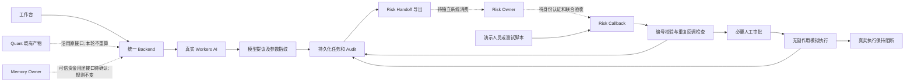
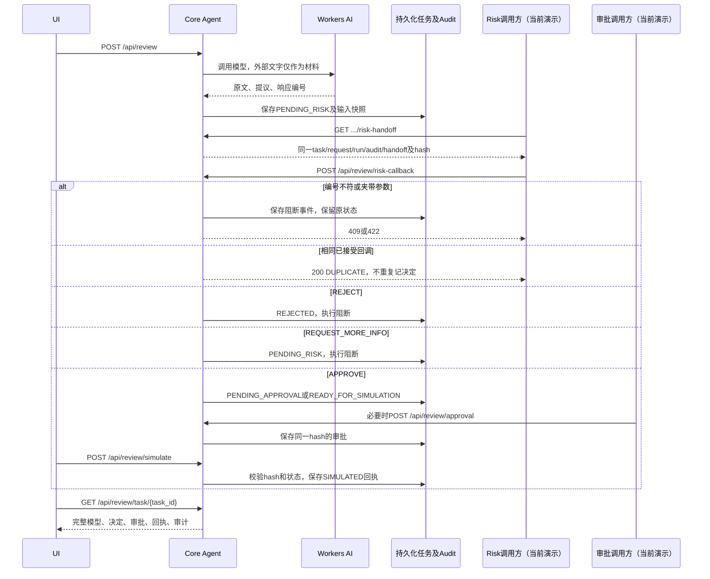

# Core Agent → Risk 联调交接 · 2026-10-14

本轮解决的是“把同一份模型提议交给 Risk，并可靠收回决定”。统一公网后端已经真实调用 Workers AI；Risk 和审批仍由演示人员或测试脚本扮演，不能称为独立 Risk 工作台已自动接通。

## 运行入口与版本

- 工作台：https://realchenchenluo.github.io/agent/risk-workbench/
- 公网后端：https://personal-ai-fund-manager-core-agent.realchenchenluo.workers.dev
- 在线接口说明：后端 `/docs`
- 当前 Worker 版本：`756201ce-d043-4c0c-8f22-43bdf7c4e681`
- Contract：`model-review.v1` / `review-workflow.v1` 保留，新增 `risk-handoff.v1` / `risk-callback.v1`。
- Schema：`../contracts/risk-handoff.v1.schema.json`；示例：`../contracts/examples/risk-callback.request.json`。

## 架构：实线为已实现，虚线为待 Owner 接入



## 调用时序与状态



`status` 在交接包内表示 Risk 状态；`workflow_status` 表示整个任务状态，两者不要混用。任务 `SIMULATED` 时，Risk 状态仍可能为 `APPROVED`。

## 最小调用方式

```javascript
const root = 'https://personal-ai-fund-manager-core-agent.realchenchenluo.workers.dev';
async function call(path, body) {
  const response = await fetch(root + path, body === undefined ? {} : {
    method: 'POST', headers: { 'Content-Type': 'application/json' },
    body: JSON.stringify(body)
  });
  const result = await response.json();
  if (!response.ok) throw new Error(result.error?.code || response.status);
  return result;
}
const task = await call('/api/review', {
  kind: 'bill', text: '虚构案例：可用现金10000元，下月房租4000元，拟投资8000元。',
  requested_action: '检查投资和房租是否冲突',
  action_parameters: { amount: 8000, currency: 'CNY', synthetic: true },
  context: { synthetic: true }
});
const handoff = await call('/api/review/' + task.run_id + '/risk-handoff');
// 演示 Risk 拒绝；正式接入必须由独立 Risk 服务产生决定并完成身份认证。
const result = await call('/api/review/risk-callback', {
  callback_version: 'risk-callback.v1',
  handoff_id: handoff.handoff_id, task_id: handoff.task_id,
  request_id: handoff.request_id, run_id: handoff.run_id, audit_id: handoff.audit_id,
  proposal_sha256: handoff.proposal.proposal_sha256,
  decision: 'REJECT', reviewer: 'synthetic-risk-owner', reason: '虚构案例需先保留房租'
});
console.log(result.callback_status, result.workflow.status);
```

这十个回调字段全部必填；额外字段不允许。字符串最长 500 字符、非空。decision 只接受 APPROVE / REJECT / REQUEST_MORE_INFO。服务端逐项核对六个关联值，字段结构校验无法代替这一步。

## 输入证据与重试

- `reviewed_input` 保存当次规范化原始输入，`evidence.input_sha256` 可核验这份输入；旧任务可能为 null，不能补造原文。
- `input_authority=UNVERIFIED_CALLER_INPUT`：新闻、账单和调用方自称的“已确认用途”都不是可信 Memory、Risk 决定或用户授权。没有写入长期 Memory。
- 完全相同的已接受回调返回 `DUPLICATE`；不新增决定或审计事件，不改变已拒绝、已模拟状态。
- 更换 decision、reviewer 或 reason 返回 `RISK_CALLBACK_CONFLICT`。六个关联值不符返回 `RISK_HANDOFF_MISMATCH`；夹带金额/执行字段或缺字段返回 `INVALID_RISK_CALLBACK`。
- 阻断事件保留在同一任务。task_id 不存在时返回 404，无法为不存在的任务创建审计链。
- `REQUEST_MORE_INFO` 当前仍锁住原决定：补全材料后创建新任务，重新调用模型和 Risk。未实现同任务多轮 Risk 修订。
- 旧 `/api/review/risk-decision` 保留兼容；已通过旧入口记录的决定不能被新回调接管。跨 Owner 新联调使用回调入口。
- 云端 Durable Object 串行处理决定并持久化；已验证重启后重复回调仍不会重复记账。

## 验证口径

- 自动测试 83/83 通过，包含 Worker 专项 9 项；语法检查通过。
- 2026-10-14 15:20–15:21（北京时间），最新版本公网 34 次 HTTP 检查全部通过，涉及三个真实模型任务。
- APPROVE 分支：Risk 回调→必要审批→模拟完成；REJECT 分支：最终拒绝；REQUEST_MORE_INFO 分支：继续等待。各分支的错误 run_id、重复回调和冲突回调都验证。
- 模型原文、provider response ID、输入快照、任务/运行/审计编号和事件保存在 `public-risk-handoff-callback-2026-10-14.json`。
- 记事本日志：`../logs/Core-Agent-公网测试记录-2026-10-14.txt`；逐请求日志：`../logs/core-agent-e2e-public-2026-10-14.jsonl`。
- 终端公网验证经本机现有代理；不能据此保证所有网络直连 Workers 域名。

发现的业务质量问题：模型能够提示投资影响房租，但风险等级不稳定，本轮最新三条响应均给出 low。APPROVE 分支是故意覆盖流程的脚本决定，绝不是对这笔投资的合理性验收。资金用途硬约束、跨任务资金占用与独立 Risk 判定仍待接入，不能宣布业务安全已完全实现。

## Owner 交接清单

| Owner | 现在可以接什么 | 还需要提供什么 |
| --- | --- | --- |
| Core Agent / Backend | 当前 Schema、导出包、回调入口、模型与审计记录 | 维护兼容及错误/重试口径 |
| Risk | 读取原始输入、模型原文和参数指纹，回写决定 | 独立部署地址、服务身份/签名、正式规则与联合验收 |
| Approval / UI | 展示当前状态，Risk 通过后记录必要审批 | 审批人身份、角色和权限；当前名字是演示标签 |
| Memory | 继续现有规则 | 用户确认资金用途的可信引用、版本、有效期和撤回协议 |
| Quant | 沿用原有产物 | 版本与证据引用确认；Core Agent 不复制计算 |
| Execution | 校验后的模拟回执 | Safety Action Gateway、跨任务余额占用与执行前再检查；未接入前不能真实执行 |

## 部署与回溯

当前全部新文件和修改都在 `chenchen/`。新增 `chenchen/deployment/` 与 `chenchen/wrangler.toml`，根目录旧 Worker 与配置保留，团队其他目录不修改。

从仓库根目录发布最新版：

```powershell
npx wrangler deploy --config chenchen/wrangler.toml
```

复测会创建三个虚构任务并消耗模型额度：

```powershell
./chenchen/scripts/verify-public-handoff.ps1 -DeploymentVersion '当前部署版本'
```

脚本输出 JSON，可通过 PowerShell `Tee-Object -FilePath` 保存；网络需要现有代理时使用可选 `-ProxyUrl`。API key 只从环境变量读取，不写入输出。历史 Git 提交与历史 Worker 版本保留；本轮前的 Worker 为 `a16ebd63-090f-402d-93ec-4f20aa4d917a`。回退时先选择历史版本并核对路由，不删除持久化审计数据，也不强制推送。
