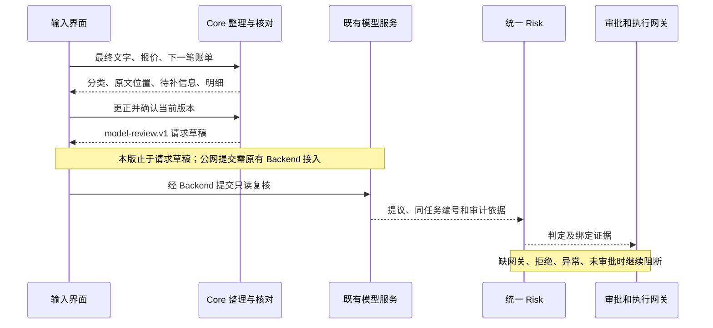

# 生活请求、购物与订阅 · Core Agent 共创版 v1

这版帮助用户先把一段话中的用钱安排看清，再把核对后的原文和报价账单交给既有模型复核。它是 **本地可运行的后端共创版**，还没有接入现有网页。旧的 `conversation-intake` v0、现有网页和已部署后端保留。

2026-10-19：小额金额保留完整小数点、角分和元角分原文；补充“不想买、没打算投资、不想取消”的否定识别，仍需核对、不自动转为执行金额。修复通过 [1000 例参数化测试](../../docs/investment-benchmark-1000-2026-10-19.md)，其中真实模型和 OCR 未调用。

## 已能做什么

- 把长句拆成可追溯条目，标出计划、已发生、假设、否定、取消、申请取消、金额更正及他人的情况；逗号后省略用途时给出待确认关联。
- 接收语音服务提供的最终转写；用户可以改错，未说完的临时转写不能提交。这里不录音、不调用语音识别服务。
- 比较明确为同一商品规格、数量的报价，逐项列出价格、运费、费用和一张可用优惠券；未知条件、过期报价和规格不符不会偷偷按零计算。
- 整理明确给出的下一笔订阅账单。申请取消仍保留可能扣款；缺金额、缺日期和逾期未核实会单列。不推测自动续费周期，不执行取消。
- 把购物和订阅核对结果绑定到同一份输入。更正金额、报价或账单后，旧确认失效；重新核对才能准备模型请求。
- 生成既有 `model-review.v1` 请求和共享 `ReportArtifact 1.0` 数据。模型只复核；没有给模型资金操作权限。

## 立即运行

在完整仓库根目录，需要 Node.js 22+，不安装第三方依赖，不需要任何 Key：

```sh
node team-staging/core-agent/life-planning-v1/run-demo.js
node chenchen/experiments/life-planning-v1/server.js
```

第二条命令启动后：

- `http://127.0.0.1:4181/fixture`：查看完整虚构案例，包括文本整理、报价账单、模型请求、替身响应、Risk 回调、审批、模拟回执和审计。
- `http://127.0.0.1:4181/example`：取得可提交给比价与账单接口的虚构输入。
- `http://127.0.0.1:4181/health`：查看本地服务状态。

这是 JSON 联调服务，不是新的产品网页。仅监听本机，不是可发给别人直接打开的公网地址。每位队友可以克隆仓库后在自己的电脑运行。现有前端无需改动。

## 接口与顺序

新路径全部是隔离的实验接口，不修改已经锁定的公共接口。

| 接口 | 输入与用途 |
| --- | --- |
| POST `/api/life/v1/intake` | `{text,data_mode,channel?,is_final?}`；`channel` 为 `text` 或 `speech_transcript`；后者要求 `is_final:true` |
| POST `/api/life/v1/revise` | `{draft_id,revision,interpretation_sha256,text}`；改字并撤销旧确认 |
| POST `/api/life/v1/attach-plan` | 绑定字段加 `{plan_input}`；`plan_input` 见 `/example`，与原文使用相同 `data_mode` |
| POST `/api/life/v1/confirm` | 绑定字段加 `{confirmed:true,reviewed_candidate_ids:[...]}`；附有报价账单时还要 `reviewed_plan_sha256` |
| POST `/api/life/v1/review-draft` | 三个绑定字段；返回可供 Backend 对接的 `request`，本接口不会调用模型 |
| POST `/api/life/v1/compare` | `/example` 中的 comparison 字段，加 `data_mode,as_of` |
| POST `/api/life/v1/subscriptions` | `/example` 中的 subscriptions 字段，加 `data_mode,as_of` |
| POST `/api/life/v1/plan` | 完整 `/example`；返回合计与共享报告数据 |



`confirm` 只说明在本地会话里核对了展示内容，不证明登录身份、银行余额或来源真实，不是 Risk 审批，也不是 Memory 写入同意。已向公共模型接口提交的历史任务不会被这个独立草稿服务修改；接入方修订已提交计划时，必须使用原有撤回/新建任务机制，不能把旧审批搬到新方案。

## 单位、来源与限制

- 比价和账单内部金额为 **人民币整数分**，共享报告表格为元（输出时除以100）。模型 context 明确 `money_unit:CNY_MINOR`。不是投资收益、持仓权重或 Quant 计算。
- 日期需要完整 ISO 时间和时区；原文中的“下个月”“月底”保留原词，不擅自推定某日或扣费顺序。给出的 `as_of` 是报价快照时点，不表示当前仍可成交。
- 规则识别不等于任意中文都能理解。反讽、复杂否定、省略和混合时态可能无法准确归类；所有条目仍须用户核对。没有自行生成风险等级或采用恩格尔系数阈值。
- 比价只覆盖提供的同规格报价；商品对应关系由调用者声明，尚未验真。只支持一张立即减免券，不叠券、不计算返现、签到或凑单，也不抓取平台数据，不保证全网最低。
- 订阅只处理明确的下一笔账单，不自动展开多年续费，不把申请取消当成功，不发通知、不自动下单或扣款。
- `LIVE` 只标记调用者声明的输入模式；来源仍为未核实输入，不代表接通银行。不要向本地共创服务放真实隐私资料。
- 草稿仅保留进程内，30分钟过期，最多128份；这不是长期 Memory。服务重启后草稿消失，现有 Memory 规则未改。
- `/fixture` 固定使用虚构数据与替身模型、替身 Risk、替身审批；不读取环境密钥、不联网，不会因真实调用失败自动切换到它。
- JSON 报告已经对齐共享契约；`export_formats:[]`。PDF、PPT、Word、Excel、图片渲染器未接入，不能宣称已支持这些文件导出。

## 验证

```sh
node --test chenchen/tests/life-planning.test.js
python chenchen/experiments/life-planning-v1/verify-report.py
cd chenchen
npm test
npm run check
```

报告校验直接读取团队的 `qiqi/contracts/report.py`，不复制、不修改对方代码。个人备份仓没有该模块时，加 `--contract <团队检出路径>/qiqi/contracts/report.py`；缺少依赖会明确失败，不自己造一份“通过”的校验器。

版本与进度见 [本次交付记录](../../docs/core-agent-life-planning-2026-10-17.md)。撤回本实验只需停止使用该入口；旧版文件不受影响。没有正式 Owner 确认前不进入 `team-release/`。
